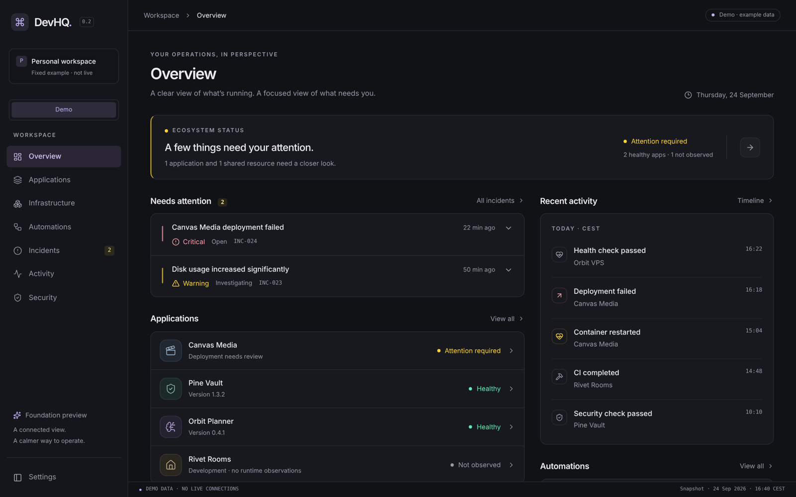
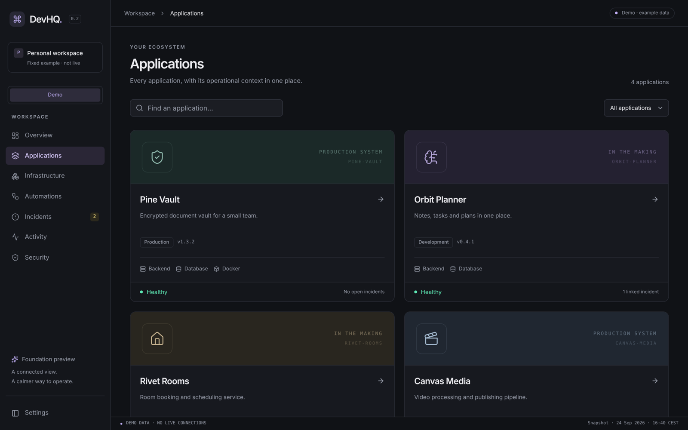

# DevHQ

Centro de operaciones **nativo de escritorio** para un ecosistema personal de software.
Su prioridad es responder **«¿Qué necesita mi atención?»**: observar aplicaciones,
recordar eventos, relacionar infraestructura y verificar resultados de automatizaciones.



## En resumen

- **Qué es:** una app de escritorio para registrar mis aplicaciones y servidores (VPS,
  estaciones de trabajo) y ver en una sola pantalla qué está sano, qué ha fallado y qué no
  se ha comprobado.
- **Para quién:** para mí. Tengo varios proyectos a la vez y quería dejar de revisarlos uno a uno.
- **Lo que la diferencia:** incluye una **puerta MCP** (`devhq --mcp`) para que agentes de IA
  como Claude Code o Codex consulten el inventario, registren observaciones y generen informes,
  con permisos que decides tú.
- **Estado:** en desarrollo activo (v0.2). Funciona en Windows y Linux.

## Stack

| Capa        | Tecnologías                                                    |
| ----------- | -------------------------------------------------------------- |
| Escritorio  | Tauri 2 (Rust)                                                 |
| Interfaz    | React, TypeScript estricto, Vite, Tailwind CSS 4, shadcn/ui    |
| Datos       | SQLite con migraciones versionadas                             |
| Integración | Model Context Protocol (JSON-RPC 2.0) para agentes de IA       |
| Calidad     | Vitest, Testing Library, Playwright, tests de Rust, ESLint, CI |

## Funcionalidades principales

- Inventario de aplicaciones y recursos de infraestructura, con sus dependencias.
- Observaciones, incidencias y eventos con origen visible (manual, comprobación HTTP o agente).
- Comprobaciones HTTP(S) a petición o supervisadas mientras la app está abierta.
- Lectura segura de copias locales de repositorios Git (sin ejecutar `git` ni hooks).
- Registro de cambios completo y copias de seguridad verificadas del inventario.



## Probarlo

```sh
npm ci
npm run dev          # demo web en http://127.0.0.1:1420
npm run tauri dev    # app de escritorio (requiere Rust y los prerrequisitos de Tauri 2)
```

Requisitos completos, pruebas y build del instalador:
[Ejecutar](docs/especificacion.md#ejecutar).

## Documentación

La **[especificación](docs/especificacion.md)** describe con precisión cómo se comporta cada
parte de DevHQ. Si un mensaje de la app, el código o un documento te remite a «el README» y a una
de sus secciones, esa sección está en la especificación. Las que más se citan:

- [Actualizar un inventario antiguo](docs/especificacion.md#actualizar-un-inventario-antiguo),
  que incluye qué hacer con un inventario antiguo que necesita recuperación
- [Trasladar el inventario fuera de AppData](docs/especificacion.md#trasladar-el-inventario-fuera-de-appdata)
- [Puerta para agentes](docs/especificacion.md#puerta-para-agentes)
- [Referencias](docs/especificacion.md#referencias)
- [Arquitectura](docs/especificacion.md#arquitectura)

Además: la [visión a largo plazo](docs/vision.md) y lo que queda por comprobar de la
[puerta para agentes](docs/puerta-para-agentes.md).
